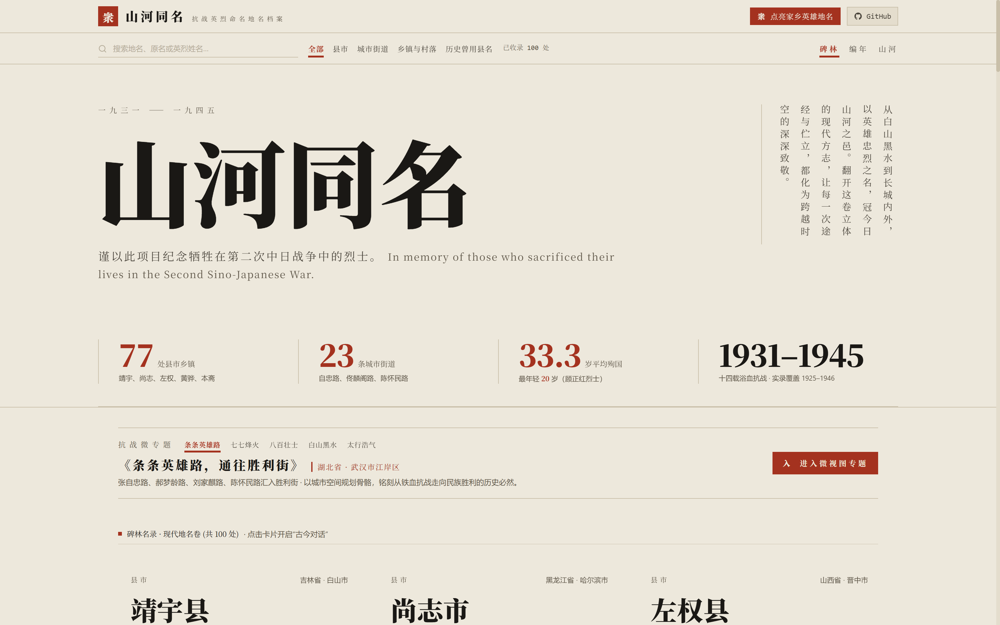
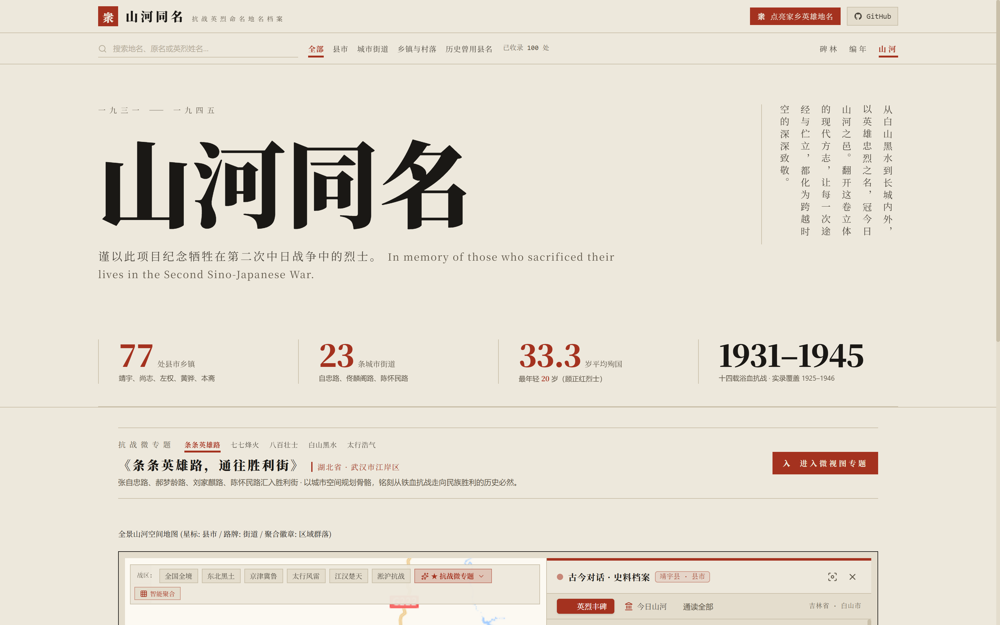

<div align="center">
  

  <br />
  <br />

  <p align="center">
    <strong>"Their names are inscribed across the mountains and rivers; the land they defended is still lived in, and lived well."</strong>
  </p>

  <p align="center">
    <em>1931–1945 · A digital archive of Chinese places named after the heroes who fell in Japan's war of aggression against China</em>
  </p>

  <p align="center">
    <a href="#about">About</a> ·
    <a href="#three-ways-to-explore">Three ways to explore</a> ·
    <a href="#five-city-exhibits">City exhibits</a> ·
    <a href="#the-archive">The archive</a> ·
    <a href="#research-principles">Research principles</a> ·
    <a href="#getting-started">Getting started</a> ·
    <a href="#contributing">Contributing</a> ·
    <a href="#technology">Technology</a> ·
    <a href="#license">License</a> ·
    <a href="./KNOWN_ISSUES.md">Known issues</a>
  </p>

  <p align="center">
    <a href="./README.en.md">English</a> · <a href="./README.md">简体中文</a>
  </p>

  <p align="center">
    
    
    
    
  </p>
</div>

---

## 📖 About

The streets we walk, the lanes we live in, the counties we come from — many of them carry names that remember a war.

- Walk through Beijing's Xicheng District and you will find Tong Linge Road and Zhao Dengyu Road running side by side.
- Along the Hai River in Tianjin, or the riverfront of Hankou in Wuhan, a Zhang Zizhong Road faces the water and the traffic.
- Open a map of China: Jingyu County in Jilin, Shangzhi in Heilongjiang, Zuoquan County in Shanxi, Huanghua in Hebei.
- In the water towns of northern Jiangsu, dozens of townships — Xuefu, Teyong, Ruifeng, Minglang — have for generations carried the names of New Fourth Army officers who fell there.
- County archives from the 1940s record wartime names such as Hongyi, Baosen, Zishi, Xuefeng and Zizhong, established during the war and later absorbed into today's administrative divisions.

Behind these names is a war — and behind the war, a generation. On 18 September 1931, Japan launched its invasion of China. The war, known internationally as the **Second Sino-Japanese War** and in China as the **War of Resistance against Japanese Aggression** (抗日战争), ended with Japan's defeat and surrender in 1945. In the fourteen years between, soldiers and civilians fell in their hundreds of thousands under the invader's guns. Their names were afterwards carved into roads, mountains, towns and counties.

Echoes of Heroes collects and presents these places. Through a map, a chronology and a directory of names, it reconnects the place names under our feet with the time and the ground of 1931–1945.

> **A note on names.** The war documented here was an act of aggression by Japan against China — in Chinese, 日本侵华战争 (Japan's war of aggression against China). Internationally it is known as the Second Sino-Japanese War; in China it is commonly called the War of Resistance against Japanese Aggression (抗日战争). The archive begins from this distinction: aggression on one side, resistance on the other.

---

## 🏛️ Three ways to explore

### 1. The directory

An ink-and-paper browse of every entry. Present names stand beside former ones; the hero's name, age at death and the sources behind the record are all in view. No dashboard clutter — just paper, ink and cinnabar red.

### 2. The chronology

A vertical timeline of the war years, with each entry hung on the moment that gave it its name. The timeline runs from the May Thirtieth Movement (1925), through the Mukden Incident (1931), the Marco Polo Bridge Incident and the Battle of Shanghai (1937), the defense of Wuhan (1938), the Hundred Regiments Offensive (1940), the counter-sweep campaigns in the Taihang Mountains (1942), to Japan's surrender and the renaming of places in 1945–46. The causal thread is always visible — from the battle where a hero fell to the renaming that followed. Yang Jingyu fell at Mengjiang County on 23 February 1940; in 1946 the county was renamed Jingyu, and so it remains.

### 3. The map

Every place pinned on a national map. The base map is AutoNavi (Amap), drawn according to the official Chinese cartography of national borders; the dark tiles sit in the page like an inkstone in its mount. The map stays left, with a pull-out panel of sources and archival notes on the right, and themed districts are traced in cinnabar and ink.

<div align="center">
  
  <p><em>The map view with its pull-out panel of sources and archival notes</em></p>
</div>

---

## 📍 Five city exhibits

Five cities have been turned into guided exhibits: activating one locks the map onto its historic streets, traces the hero roads in cinnabar and ink, and opens a narrative panel.

| ID | Exhibit | Area | What it shows |
| :--- | :--- | :--- | :--- |
| `wuhan` | Every hero road leads to Victory Street | Jiangan District, Wuhan, Hubei | Zhang Zizhong Road, Hao Mengling Road, Liu Jiaqi Road and Chen Huaimin Road meet Victory Street — the fallen paid in blood so that the nation could move from suffering to victory. |
| `beijing` | The twin heroes of July 7 | Xicheng District / Lugou Bridge, Fengtai, Beijing | Tong Linge Road and Zhao Dengyu Road, running north and south outside Xuanwu Gate, answer the Marco Polo Bridge and Wanping — remembering the 29th Army's stand at Nanyuan in 1937. |
| `shanghai` | Eight hundred heroes on the Suzhou Creek | Jing'an / Baoshan, Shanghai | Jinyuan Road on the Suzhou Creek faces the Sihang Warehouse across the water; Ziqing Road in Baoshan remembers Battalion Commander Yao Ziqing and the garrison who died with him. |
| `harbin` | Four commanders of the Northeast resistance | Daoli District, Harbin, Heilongjiang | Shangzhi Avenue, Jingyu Street, Zhaolin Street and Yiman Street ring the city center south of the Songhua River — fourteen years of unbroken resistance. |
| `zuoquan` | The spirit of the Taihang, a star fallen at Shiziling | Zuoquan County, Jinzhong, Shanxi | From the former Eighth Route Army headquarters at Matian in the Taihang Mountains to the Qingzhang River valley below Shiziling — the story of how Liao County was renamed Zuoquan. |

---

## 📊 The archive

The first phase contains **100 entries** across **16 provinces and municipalities**, every one backed by written sources. The entries are organized into five sections:

- **Section 1 — Counties and wartime county names (20)**: Jingyu County (Yang Jingyu), Shangzhi (Zhao Shangzhi), Zuoquan County (Zuo Quan), Huanghua (Huang Hua); and wartime counties later absorbed into modern divisions — Hongyi, Baosen, Zhengtang, Qizhi, Linge, Zhuxian, Liqi, Zhuting, Dengyu, Xuefeng, Zishi, Zizhong, and others.
- **Section 2 — Hero roads in major cities (20)**: Tong Linge Road, Zhao Dengyu Road and Zhang Zizhong Road in Beijing; Zhang Zizhong Road and Ji Hongchang Road in Tianjin; Jinyuan Road, Ziqing Road, Jingyu East Road, Yiman Street and Anlan Road in Shanghai; Zhang Zizhong, Hao Mengling, Liu Jiaqi, Chen Huaimin and Lugouqiao Roads in Wuhan; Shangzhi Avenue, Jingyu Street, Zhaolin Street and Yiman Street in Harbin; Zhang Zizhong Road in Beibei, Chongqing.
- **Section 3 — New Fourth Army towns of the central-China bases (25)**: the densest cluster of martyr-named towns in the country, in Yancheng, Nantong and Huai'an, Jiangsu — Xuefu, Teyong, Minglang, Ruifeng, Zefu, Hede, Dazhong, Zhendong, Baiding, and more.
- **Section 4 — Villages and towns of the North China bases (20)**: Benzha Hui Township in Liaocheng, Shandong (Ma Benzhai); Benzha Village in Xianxian, Hebei; Wuyong Village and Langya Mountain Village in Yixian (the Five Heroes of Langya Mountain).
- **Section 5 — Places remembering the Northeast Anti-Japanese United Army (15)**: Hanzhang Township in Dunhua, Jilin (Chen Hanzhang); Zhenbo Village in Wangqing; Renyi Township in Shangzhi and Hongsheng Village in Tieli, Heilongjiang.

We do not claim this archive is free of error — scholarship on these names is meant to be challenged and corrected. Problems the editors have confirmed, modeling gaps and entries still awaiting verification are published openly in [`KNOWN_ISSUES.md`](./KNOWN_ISSUES.md). If you hold a better source, we would like to hear from you.

---

## 🔍 Research principles

1. **Cross-check everything.** Every entry is checked against the Dictionary of Place Names of the People's Republic of China, local gazetteers, wartime archives, and the official roll of martyrs maintained by the Ministry of Veterans Affairs.
2. **Never present speculation as fact.** The archive distinguishes "named in honor of a person" from "site of an event." Where a place was named for a hero's deeds though he was never born or killed there — Yiman Street in Harbin, for example — the entry says so plainly.
3. **Record history faithfully.** Wartime counties later merged or renamed after the war (Baosen County merged into Zunhua; Zishi County renamed Hai'an) keep their full history in the record.
4. **The criterion is the naming, not the year of death.** The archive includes places named in honor of war heroes whose names survive today or appear in administrative records. A few entries therefore fall outside 1931–1945: Gu Zhenghong, killed in the May Thirtieth Movement in 1925, gave his name to Zhenghong Town when the New Fourth Army's Third Division set it up around 1943; Li Zhaolin, assassinated in 1946, gave his name to Zhaolin Street in Harbin for his service in the Northeast resistance. These are not errors — reading the archive as a roll of the fallen between 1931 and 1945 would be (see [`KNOWN_ISSUES.md`](./KNOWN_ISSUES.md), #2).

---

## 🚀 Getting started

Built with Next.js 16; requires **Node.js ≥ 20.9**.

```bash
git clone https://github.com/KirishimaEri/echoes-of-heroes.git
cd echoes-of-heroes
npm install
npm run dev
```

Open [http://localhost:3000](http://localhost:3000).

Build and verification commands and engineering details: [TECHNICAL.md](./TECHNICAL.md).

---

## 🤝 Contributing

Our own eyes are limited, and China's land is vast. If you find in local gazetteers, hometown archives or historical materials a place named for a war hero that the archive has not yet recorded, you are warmly welcome to help build it.

### Standards

1. **Every claim needs a source** — no social-media hearsay, travel articles or unattributed retellings. Give the title of the work, ideally with volume and page. The archive's 311 citations currently cannot be clicked through to verify (see [`KNOWN_ISSUES.md`](./KNOWN_ISSUES.md), #4); adding verifiable references is the most valuable contribution you can make.
2. **Distinguish "named in honor of" from "site of an event."** Only the former belongs in the main collection; if the latter is worth including, say so in the pull request and we will consider listing it separately.
3. **The criterion is when the place was named**, not whether the hero died between 1931 and 1945 (see Research principles, #4).

### Data fields and workflow

⚠️ **Do not edit `src/data/places.json` directly.** It is a generated file. The real sources are the five sector files `scripts/data/sector1.json` … `sector5.json`; anyone running `node scripts/merge_places.js` overwrites `places.json` entirely from them — direct edits are silently wiped.

```bash
# 1. Add the new record to the sector file of its section (Section 3 → sector3.json, etc.)
# 2. Regenerate the master data file
node scripts/merge_places.js
# 3. Self-check
npm run typecheck && npm run lint
```

A complete record has the following fields (`merge_places.js` only enforces the existence of `id`, `modern_name`, `hero`, `coordinates` and the uniqueness of `id`; the rest is up to you):

| Field | Meaning | Notes |
| :--- | :--- | :--- |
| `id` | Stable identifier | Suggest `province-city-name` in lowercase Latin with hyphens; unique across the archive |
| `modern_name` | Current name | |
| `former_name` | Former name | **Not** `historical_name` |
| `category` | `县市` (county/city) / `街道` (street) / `乡镇与村落` (town and village) / `历史曾用县名` (former wartime county name) | An unused `乡镇` value exists in the type; do not add new uses |
| `province` / `city` | Province and city | Cross-province: `省A/省B`, both full names |
| `coordinates` | **`[longitude, latitude]`** | Opposite order from `thematics.ts` (`[lat, lng]`); see KNOWN_ISSUES #6 |
| `renamed_year` | Year of naming/renaming | |
| `hero.name` | Hero's name or collective designation | Collective entries should say so in the name (e.g. "…group") |
| `hero.birth_year` / `death_year` / `sacrifice_age` | Birth year, death year, age at death | Individual records must satisfy `death_year − birth_year = sacrifice_age`; collective entries use representative values |
| `hero.title` / `force` / `sacrifice_date` / `battle` / `story` | Rank, affiliation, time and place of death, deeds | `force` has no enum whitelist; check existing values before adding synonyms |
| `modern_status` | Current state and use of the place | |
| `sources` | Array of sources | One item per source; more is better |

Submit a pull request, or leave a note through the "点亮家乡英雄地名" (light up your hometown's hero names) entry on the site. Pull requests are preferred, because they keep sources in a traceable place. For errata submission and attribution, see [CONTRIBUTING.md](./CONTRIBUTING.md).

---

## 💻 Technology

- **Stack**: Next.js 16 · TypeScript · Tailwind CSS v4 · Leaflet / React Leaflet
- **Deployment**: pure static export; the output has no server-side dependencies and can be hosted on GitHub Pages, Cloudflare Pages or any static server at near-zero cost.
- **Offline**: the directory and chronology views work fully offline. Map tiles load at runtime, so without a network the map background is blank — but the markers, themed paths and archive data all come from local files. The base map is AutoNavi only, drawn according to the official Chinese cartography of national borders; no overseas tile sources are provided (see [`KNOWN_ISSUES.md`](./KNOWN_ISSUES.md), #5).

---

## 👥 Team

The project was initiated and is maintained by [@KirishimaEri](https://github.com/KirishimaEri), and built by a human–AI collaboration team of large language models — from data research and code to interface design:

| Member |
| :--- |
| Gemini 4 Argon |
| Qwen 3.8 flash |
| Gemini 3.8 flash |
| GLM 5.3 flash |
| Claude Opus 4.6 |
| Grok 4.6 |
| Seed 2.1 Pro |
| Step 5 Preview |

> All key historical judgments rest on sources verified by human review; model output is cross-audited and checked entry by entry before inclusion. Errata: [`KNOWN_ISSUES.md`](./KNOWN_ISSUES.md).

---

## ⚖️ License

Code and data are licensed separately:

| Content | License |
| :--- | :--- |
| Code (everything in `src/` except data and scripts) | **MIT** ([`LICENSE`](./LICENSE)) |
| Historical data (`src/data/`, `scripts/data/`) | **CC BY-SA 4.0** ([`LICENSE-DATA.md`](./LICENSE-DATA.md)) |

The data license uses the ShareAlike and Attribution clauses: corrections to the data flow back to the public version, and the names of the editors and the gazetteers they cite travel with the data. When you reuse a record, keep its `sources` field and credit as required by `LICENSE-DATA.md`. No warranty, express or implied, is made for historical accuracy.

---

## 🕊️ In memory

<div align="center">
  <br />
  <h3>愿中华无恙 · 愿河山一统 / May China be at peace, and the land remain whole.</h3>
  <br />
  <p><em>「天地英雄气，千秋尚凛然。」 — "The spirit of heroes fills heaven and earth, and endures through the ages."</em></p>
  <p>
    In memory of all who gave their lives in 1931–1945 and in the long struggle that preceded it,<br />
    for the independence of the nation, the liberation of the people, and the dignity of the country.
  </p>
  <br />
  <sub>Echoes of Heroes · History begins with the names beneath our feet.</sub>
</div>
