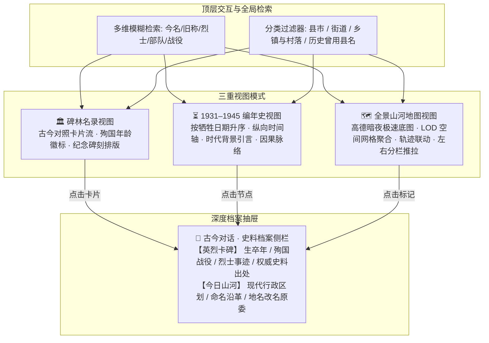
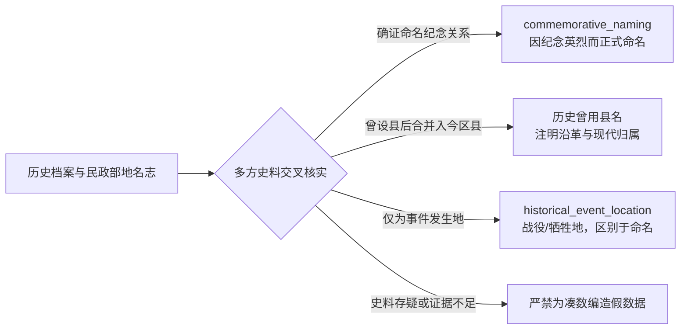

<div align="center">
  

  <br />
  <br />

  <p align="center">
    <strong>「他们的名字镌刻在山河之间；他们守护的土地，仍有人在认真生活。」</strong>
  </p>

  <p align="center">
    <em>1931 — 1945 · 全景抗日英烈命名地名数字档案与空间叙事系统</em>
  </p>

  <p align="center">
    <a href="#-项目缘起">项目缘起</a> ·
    <a href="#-三大核心视图">三大核心视图</a> ·
    <a href="#-五大历史空间微专题">空间微专题</a> ·
    <a href="#-百处地名档案矩阵">地名档案矩阵</a> ·
    <a href="#-史料考据原则">史料考据原则</a> ·
    <a href="#-技术架构与性能优化">技术架构</a> ·
    <a href="#-快速开始">快速开始</a> ·
    <a href="#-参与贡献">参与贡献</a> ·
    <a href="#-许可与数据使用">许可</a> ·
    <a href="./KNOWN_ISSUES.md">已知问题与勘误</a>
  </p>

  <p align="center">
    
    
    
    
    
    
    
    
    
  </p>
</div>

---

## 📖 项目缘起

我们每天走过的路、居住的街巷、生活的县市，常常叠印着一段段未曾远去的民族记忆。

- 漫步在**北京**的街头，西城区并立着**佟麟阁路**与**赵登禹路**；
- 漫步在**天津**海河之滨或**武汉**汉口江岸，**张自忠路**静静面迎江水与车流；
- 翻开中国地图，吉林有**靖宇县**、黑龙江有**尚志市**、山西有**左权县**、河北有**黄骅市**；
- 深入苏北里下河水乡，**学富镇、特庸镇、瑞丰镇、明朗村**，数十座乡镇以牺牲于此的新四军指战员之名世代相传；
- 追溯 1940 年代的解放区区划档案，更曾设立过**宏毅县、包森县、紫石县、雪枫县、自忠县**……

**《山河同名》** 旨在构建一座数字化、空间化、学术严谨的抗战英烈命名地名交互档案库。通过现代地图与时间轴，将我们脚下的地名坐标与 1931—1945 年抗战英烈的殉国时空重新连接。

这不是一份冰冷的行政代码清单，而是一部**以大地为石碑、以地名为碑文**的民族精神谱系。

---

## 🏛️ 三大核心视图

系统提供三种互相贯通的观察维度，兼顾**典籍阅读感**、**编年因果感**与**地理沉浸感**：



### 1. 🏛️ 碑林名录视图（Monumental Directory）
- **金石碑刻排版**：摒弃管理后台式的杂碎控件，采用深邃青铜暗色调（`stone-950`）与苍劲衬线大字体，营造纪念馆纪念碑林的呼吸感与肃穆感。
- **古今地名同框**：醒目呈现【今名（如：靖宇县）】，并以历史划线标注【旧称：濛江县（1946年更名）】。
- **英烈与年龄徽章**：左下突出烈士姓名与殉国年龄徽章（如“殉国时 35 岁”），右下直通权威史料。

### 2. ⏳ 1931–1945 抗战编年史视图（Chronicle Timeline）
- **纵向时空长廊**：贯穿 1931 至 1945 年的历史时间轴，各关键历史节点注入时代背景引言：
  - *1931 九一八事变与十四年抗战起点*
  - *1937 卢沟桥事变与全民族抗战爆发*
  - *1938 浴血台儿庄与保卫大武汉*
  - *1940 极寒十四载白山黑水与百团大战*
  - *1942 太行反扫荡与绝境孤忠*
- **因果脉络清晰呈现**：节点挂接烈士卡片，清晰呈现从 **“牺牲战役 ➔ 命名更名”** 的因果链条（例如：*1940年2月23日 杨靖宇将军于濛江县殉国 ➔ 1946年 濛江县更名为靖宇县，沿用至今*）。

### 3. 🗺️ 全景山河空间地图视图（Spatial Cartography）
- **高德夜色深灰底图**：国内高可用 CDN 极速分块加载，彻底告别海外瓦片网络抖动与第三方 API 阻碍。
- **左右分栏双视窗**：左侧为无遮挡空间地图，右侧推拉弹出独立的【古今对话·史料档案】深度研读面板，彻底解决浮窗遮挡地图操作与视野的痛点。
- **相机动态响应**：支持战区快速跳跃（东北黑土、京冲冀鲁、太行风霜、江汉楚天、淞沪抗战），并在侧栏提供微脉冲【居中地图视角】对齐功能。

<div align="center">
  
  <p><em>全景山河地图与右侧「古今对话·史料档案」推拉抽屉联动实机展示</em></p>
</div>

---

## 📍 五大历史空间微专题

在地图视图中，特别设计了**城市空间微专题叙事模式**。激活专题后，地图视角将自动锁定目标历史街区，以朱砂红绘制英雄路段走向，以亮金线勾勒交汇走向，配合专题导览抽屉展开叙事：

| 专题代号 | 专题名称 | 核心地理空间 | 重点道路与空间叙事 |
| :--- | :--- | :--- | :--- |
| **`wuhan`** | **条条英雄路，通往胜利街** | 湖北省武汉市江岸区 | 贯穿**张自忠路、郝梦龄路、刘家麒路、陈怀民路**，与之垂直交汇的即为**胜利街**。寓意无数先烈血洒山河，其终点是中华民族从苦难走向胜利。 |
| **`beijing`** | **七七烽火，铁血双雄** | 北京市西城区 / 丰台卢沟桥 | 宣武门内外南北并行的**佟麟阁路**与**赵登禹路**，呼应卢沟桥宛平城，铭刻抗战初期二十九军血战南苑之壮举。 |
| **`shanghai`** | **八百壮士，血铸苏州河** | 上海市静安区 / 宝山区 | 苏州河畔的**晋元路**与**四行仓库**隔河相望；宝山老城厢的**子青路**铭记宝山守城孤胆营长姚子青与全营殉国将士。 |
| **`harbin`** | **白山黑水，抗联四杰耀松江** | 黑龙江省哈尔滨市道里区 | 松花江南岸的核心干道**尚志大街、靖宇街、兆麟街、一曼街**环绕市中心，串联起东北抗日十四载不屈脊梁。 |
| **`zuoquan`** | **太行浩气，星陨十字岭** | 山西省晋中市左权县 | 环绕太行山脉麻田八路军总部旧址至十字岭清漳河谷，记录辽县易名左权县的悲壮历程与太行浩气。 |

---

## 📊 百处地名档案矩阵

本系统第一阶段已实装 **100 处**抗战英烈地名档案：每条记录均标注史料出处，并经编者对照地名志、地方志与公开英烈名录交叉比对后收录。覆盖全国 16 个省、自治区和直辖市，划分为五大历史板块。

我们不做「绝无讹误」的承诺——史料考据是可以被继续推翻的。编者自查中已确认的口径问题、建模缺陷与待核条目，公开列于 [`KNOWN_ISSUES.md`](./KNOWN_ISSUES.md)；若你掌握更好的出处，欢迎据其勘误。

```
                    ┌── 板块一：现存县市与历史曾用烈士县名 (20处)
                    ├── 板块二：全国大中城市核心抗战英雄道路 (20处)
百处抗战英烈地名 ────┼── 板块三：华中新四军与敌后根据地密集乡镇 (25处)
                    ├── 板块四：华北太行、吕梁与冀鲁抗日根据地村镇 (20处)
                    └── 板块五：东北抗日联军及其他知名抗战纪念地名 (15处)
```

### 数据板块概览

#### 1. 板块一：现存县市与历史曾用烈士县名（20处）
- **现存烈士县市**：吉林省靖宇县（杨靖宇）、黑龙江省尚志市（赵尚志）、山西省左权县（左权）、河北省黄骅市（黄骅）。
- **抗战时期政权设立的历史曾用烈士县名**（后合并归入现代行政区划）：
  - 河北：**宏毅县**（杨宏毅）、**包森县**（包森）、**振堂县**（季振堂）、**企之县**（马企之）、**麟阁县**（佟麟阁）；
  - 山东：**筑先县**（范筑先）、**理琪县**（理琪）、**竹庭县**（符竹庭）、**登禹县**（赵登禹）；
  - 苏皖豫：**雪枫县**（彭雪枫）、**紫石县**（韩国钧）；
  - 湖北：**自忠县**（张自忠）、**洪山县**（贺锦斋）等。

#### 2. 板块二：全国大中城市核心抗战英雄道路（20处）
- **北京**：佟麟阁路、赵登禹路、张自忠路；
- **天津**：张自忠路、吉鸿昌路；
- **上海**：晋元路、子青路、靖宇东路、一曼街、安澜路；
- **武汉**：张自忠路、郝梦龄路、刘家麒路、陈怀民路、芦沟桥路；
- **哈尔滨**：尚志大街、靖宇街、兆麟街、一曼街；
- **重庆**：北碚张自忠路。

#### 3. 板块三：华中新四军根据地烈士命名乡镇（25处）
江苏省盐城（阜宁、射阳、建湖、盐都、东台、大丰）及南通、淮安等地拥有全国最密集的新四军烈士命名乡镇，完整收录：
- **学富镇**（杨学富烈士，苏中公学政治部主任）
- **特庸镇**（胡特庸烈士，鲁迅艺术学院华中分院美术系主任兼特务连指导员）
- **明朗乡**（廉明朗烈士）、**瑞丰镇**（唐瑞丰烈士）、**泽夫镇**（王泽夫烈士）、**合德镇**（王合德烈士）
- **大中街道**（刘大中烈士）、**振东乡**（吴振东烈士）、**白丁镇**（罗白丁烈士）、**郭村镇**、**芦蒲镇** 等。

#### 4. 板块四：华北太行、吕梁与冀鲁根据地村镇（20处）
- **山东聊城**：本斋回族乡（马本斋司令员）；
- **河北献县**：本斋村（马本斋母子两代英烈）；
- **河北易县**：五勇村、狼牙山村（狼牙山五壮士）；
- **山西太行与吕梁**：多处抗日烈士命名行政村。

#### 5. 板块五：东北抗日联军及其他英烈纪念地（15处）
- **吉林敦化**：翰章乡（东北抗日联军第一路军第三方面军总指挥 陈翰章）；
- **吉林汪清**：振波村（陈振波烈士）；
- **黑龙江尚志/铁力**：仁义乡（曹仁义烈士）、宏生村 等。

---

## 🔍 史料考据原则

历史纪念必须建立在审慎与诚实的基础之上。本项目的方法承诺是：**宁可标注存疑，绝不以未经证实的表述填补空缺**；并尽力使每条记录可被后人检索、复核与推翻。



1. **多重档案交叉印证**：
   每一条收录均查验《中华人民共和国地名大词典》、地方志（县志/区志）、抗战档案馆文献、退役军人事务部（原民政部）抗日英烈名录。
2. **拒绝将猜测当作事实**：
   严格区分“因纪念某人而命名”与“历史事件发生于某地”；对英烈并未在此地出生或牺牲，但因其功勋被当地命名的（如哈尔滨一曼街），明确注明其命名缘由与沿革。
3. **忠实记录历史沿革与现代区划**：
   对解放战争及建国后撤销合并的历史烈士县（如冀东包森县撤并入遵化市、清河紫石县更名为海安市），均在 `renamed_year`、`modern_status` 与 `hero.story` 中完整保留时代印记。
4. **判定标准是「命名行为」，不是「牺牲年份」**：
   本项目收录的是**因抗战英烈纪念而得名、且该名沿用至今或见于区划档案**的地名。因此个别记录的牺牲年份会略越 1931–1945——如顾正红 1925 年牺牲于五卅运动，但其故里的「正红区/正红镇」是 1943 年前后由新四军三师命名的；李兆麟 1946 年遇害，哈尔滨兆麟街等命名源于其抗联功绩。**这不是数据错误**，把它读成"1931–1945 英烈名录"才会产生误解，故在此明确口径（详见 [`KNOWN_ISSUES.md`](./KNOWN_ISSUES.md) 第 2 条）。

---

## 💻 技术架构与性能优化

项目采用纯静态导出方案，具备极高的加载速度、极佳的安全性和近乎零成本的部署能力。

```
src/
├── app/
│   ├── layout.tsx         # 全局元数据与字体定义 (Geist Sans / Mono)
│   ├── page.tsx           # 首页聚合视图 (状态驱动: 碑林名录 / 编年史 / 山河地图)
│   └── globals.css        # 墨金青铜历史色系主题定制
├── components/
│   ├── HeroSection.tsx    # 典雅纯净的首屏横幅区
│   ├── TimelineView.tsx   # 1931-1945 纵向编年史时间轴
│   ├── PlaceCard.tsx      # 碑刻风格地名卡片
│   ├── DetailModal.tsx    # 碑林/编年史深度弹窗
│   └── Map/
│       ├── index.tsx                # Next.js 动态载入 (禁用 SSR) 封装
│       ├── LeafletMap.tsx           # 核心地图底图 (Canvas渲染 + DivIcon缓存池 + LOD网格聚合)
│       ├── MapSideDetailPanel.tsx   # 左右分栏推拉式史料档案抽屉 (含居中微脉冲)
│       └── ThematicSpecialPanel.tsx # 五大空间微专题互动叙事抽屉
└── data/
    ├── places.json        # 100 处真实考据地名核心数据库
    └── thematics.ts       # 五大城市空间微专题空间坐标与叙事数据
```

### 关键工程亮点
- **零 GC 图标缓存池**：
  Leaflet 在处理大量自定义 `divIcon` 时，频繁的 DOM 创建与销毁会导致 React 发生微卡顿。我们在 [`src/components/Map/LeafletMap.tsx`](./src/components/Map/LeafletMap.tsx) 中构建了单例图标缓存池（`monumentIconCache` / `clusterIconCache`），使 100+ 标记点在平移与重渲染时复用同一 `L.DivIcon` 实例，不再重复构造图标对象与 DOM 片段。
- **HTML5 Canvas 硬件矢量加速**：
  开启 `preferCanvas={true}`，所有专题路径、边界线均绘制于单个 Canvas 画布，避免 SVG 树节点爆炸。
- **LOD 智能空间聚合（Grid Clustering）**：
  大尺度全国视角（Zoom < 8）下自动进行轻量级网格聚合显示片区徽章；放大时无缝散开为精美地标，兼顾宏观气势与微观精度。
- **纯静态导出，部署近乎零成本**：
  配置 `output: 'export'`，产物为纯静态 HTML/JS/CSS，无服务端依赖，可直接托管于 GitHub Pages、Cloudflare Pages 或任意静态服务器。
- **离线可用范围（诚实说明）**：
  代码与数据完全本地化（Leaflet 本体已打包进产物，无 CDN 依赖），因此**碑林名录与编年史视图离线可全功能使用**；地图视图的瓦片为运行时网络请求，断网时底图区域为空白，但标记、专题路径与档案抽屉的数据仍来自本地。底图仅保留高德（AutoNavi）两套，因其按官方画法渲染国界；不提供 OSM 等境外瓦片源，原因见 [`KNOWN_ISSUES.md`](./KNOWN_ISSUES.md) 第 5 条。

---

## 🚀 快速开始

### 依赖环境
- **Node.js >= 20.9.0**（由 `next@16` 的 `engines` 字段强制要求；Node 18 无法构建本项目）
- npm / pnpm / yarn

### 本地运行
```bash
# 1. 克隆代码仓库
#    ⚠️ 下方 YOUR_GITHUB_USERNAME 为待替换占位符，见「发布前待办」
git clone https://github.com/YOUR_GITHUB_USERNAME/echoes-of-heroes.git
cd echoes-of-heroes

# 2. 安装依赖包
npm install

# 3. 启动本地开发服务 (Next 16 默认使用 Turbopack)
npm run dev
```
启动后在浏览器访问 [http://localhost:3000](http://localhost:3000)。

### 生产打包与验证
```bash
# 类型检查（独立于构建，可单独跑）
npm run typecheck

# ESLint
npm run lint

# 生成静态产物到 out/
npm run build

# 本地预览静态生成结果
# 注意：next.config.ts 为 output: "export"，产物是纯静态文件，
#      `next start`（Node 生产服务器）在此模式下不可用，须用静态服务器预览。
npx serve out
```

### 发布前待办
本仓库尚无线上地址，以下三处在公开前需要一次性替换，且已收敛到唯一定义处：

| 待替换项 | 位置 |
| :--- | :--- |
| GitHub 仓库地址（站内 GitHub 按钮、Issue 链接） | `src/lib/site.ts` 的 `REPO_OWNER` |
| 线上访问地址（用于 canonical 与分享卡片） | `src/lib/site.ts` 的 `SITE_URL` |
| 本文与 `LICENSE-DATA.md` 中的 `YOUR_GITHUB_USERNAME` | `README.md`、`LICENSE-DATA.md` |

在 `REPO_OWNER` 仍为占位符期间，页面上的 GitHub 按钮**不会渲染**——指向 GitHub
首页或不存在的仓库，都比不显示更糟。

---

## 🤝 参与贡献

我们深知个人的视野有限，而华夏山河辽阔。如果您在地方志、家乡档案、文史资料中发现尚未被系统收录的抗日英烈命名地名，热烈欢迎参与共建！

### 贡献标准

1. **必须有可查出处**：不接受自媒体段子、旅游软文与无署名转述。请给出文献名，
   能到卷/册/页更好（现有 311 条出处的短板正是无法点击核验，见
   [`KNOWN_ISSUES.md`](./KNOWN_ISSUES.md) 第 4 条，你的补充就是在补这个项目最大的弱点）。
2. **区分「因纪念而命名」与「事件发生地」**：只有前者进主集合；后者如需收录，
   请在 PR 中说明，我们会评估是否单列。
3. **收录口径以命名时间为准**，不以牺牲年份是否在 1931–1945 内为准（详见
   「史料考据原则」第 4 条）。

### 数据字段与提交流程

⚠️ **不要直接改 `src/data/places.json`。** 它是生成产物，真实源文件是按五大板块
拆分的 `scripts/data/sector1.json` … `sector5.json`；任何人执行
`node scripts/merge_places.js` 都会用源文件整体覆盖 `places.json`，直接改动会被静默清空。

正确流程：

```bash
# 1. 把新记录加进它所属板块的源文件（板块三 → sector3.json，以此类推）
# 2. 重新生成主数据文件
node scripts/merge_places.js
# 3. 自检
npm run typecheck && npm run lint
```

一条记录的完整字段（`merge_places.js` 仅强制 `id`、`modern_name`、`hero`、
`coordinates` 存在与 `id` 不重复，其余请自行保证）：

| 字段 | 含义 | 注意 |
| :--- | :--- | :--- |
| `id` | 稳定标识 | 建议 `省份-市-名` 的拉丁小写连字符形式，全库唯一 |
| `modern_name` | 今名 | |
| `former_name` | 旧称 | **不是** `historical_name` |
| `category` | `县市` / `街道` / `乡镇与村落` / `历史曾用县名` | 类型里还有个零使用的 `乡镇`，请勿新增使用 |
| `province` / `city` | 省级、市级归属 | 跨省用 `省A/省B`，两侧均为全称 |
| `coordinates` | **`[经度, 纬度]`** | 与 `thematics.ts` 的 `[纬度, 经度]` 相反，见 KNOWN_ISSUES 第 6 条 |
| `renamed_year` | 命名/更名年份 | |
| `hero.name` | 英烈姓名或集体称谓 | 群体条目请在命名中体现（如「…群体」「…群英」） |
| `hero.birth_year` / `death_year` / `sacrifice_age` | 生卒与殉国年龄 | 个人记录须满足 `death_year − birth_year = sacrifice_age`；群体条目为代表年岁，不适用该式 |
| `hero.title` / `force` / `sacrifice_date` / `battle` / `story` | 头衔、阵营、殉国时间地点与事迹 | `force` 暂无枚举白名单，新增同义词前先查现有取值 |
| `modern_status` | 今日地貌与使用状况 | |
| `sources` | 史料出处数组 | 每条一项，宁多勿缺 |

提交 Pull Request，或通过主页「点亮家乡英雄地名」入口留言均可；PR 优先，因为它
能让出处留在可追溯的位置。

---

## ⚖️ 许可与数据使用

本项目采用**代码与数据分离的双层授权**：

| 内容 | 许可 | 文件 |
| :--- | :--- | :--- |
| 代码（`src/` 除 `src/data/`、`scripts/`、配置文件） | **MIT** | [`LICENSE`](./LICENSE) |
| 史料数据（`src/data/`、`scripts/data/`） | **CC BY-SA 4.0** | [`LICENSE-DATA.md`](./LICENSE-DATA.md) |

拆分的理由：宽松代码许可并不适合编辑性汇编的历史数据——**ShareAlike 条款保证
他人对你我数据的修正会回流到公共版本**，而不是被吸收进闭源衍生品；**Attribution
条款保证编纂者与所引方志的署名随数据一同流转**。

复用数据时请保留每条记录自带的 `sources`，并按 `LICENSE-DATA.md` 的格式署名。
对史实准确性本项目不提供任何明示或默示担保——已知问题见 `KNOWN_ISSUES.md`。

---

## 🕊️ 致敬先烈

<div align="center">
  <br />
  <h3>愿中华无恙 · 愿河山一统</h3>
  <br />
  <p><em>「天地英雄气，千秋尚凛然。」</em></p>
  <p>
    谨以此数字系统，致敬所有在 1931 — 1945 年及漫长救亡征程中，<br />
    为争取民族独立、人民解放与国家尊严而英勇捐躯的烈士先锋。
  </p>
  <br />
  <sub>《山河同名》项目组 · 让历史从我们脚下的地名开始</sub>
</div>
